# File Studio — a custom widget for Grist (by ANUPRESS)

[](LICENSE)
[](CHANGELOG.md)

File Studio is a gallery, viewer, editor and file manager for the files in your Grist
**Attachments** columns. It shows them the way people look at files:
as **cards** with a cover picture, as a **wall of files**, or one record at a time in a **viewer**.
Any file opens large, whether a photo, a PDF, a video, a voice note, a CSV or a text file. Pictures
text files and PDFs can be edited and saved back in place; PDFs and photos can be merged. Drop files in, paste a screenshot, copy or move
them between records, see every cell a file sits in, rename them by a pattern, and download them as
one zip named after your columns. It runs entirely in the viewer's browser: there is no server, and your
files go only between the browser and your own Grist.

Paste this into Grist (**Add widget → Custom → Enter Custom URL**):

```
https://anupress.github.io/grist-file-studio/
```

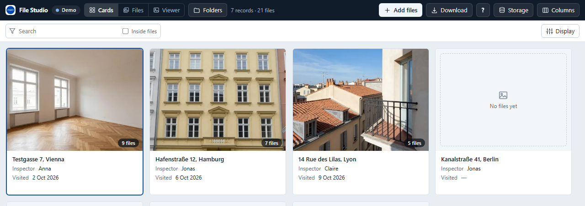

## Try it without Grist

Opened in a plain browser tab, the widget runs on sample property inspections and saves nothing:
**[the demo](https://anupress.github.io/grist-file-studio/)**. Add `?example=speed` for
2,000 records with 10,000 files.

## The three layouts

| Layout | Shows | What you do in it |
|---|---|---|
| **Cards** | one card per record: the cover picture, the title, up to four fields | hover the cover to flip through its pictures, drop files on a card, click to select the record |
| **Files** | every file of the records shown, in justified rows or squares, with a heading per record | search, filter by type, sort, mark several and zip, rename or remove them |
| **Viewer** | the selected record's files, large, with a filmstrip | follow a table next to it, drag the filmstrip to reorder, make a cover, add files |

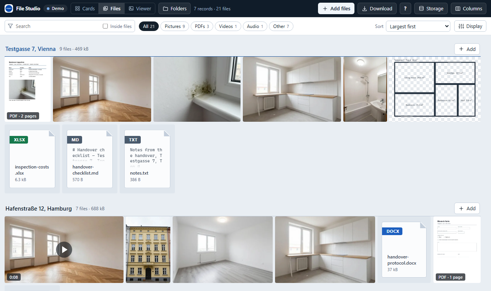

Next to a Grist table, the **Viewer** is the attachment viewer people have asked Grist for: link it
to the table (**Select by**, same record) and it shows the files of whichever row is selected.

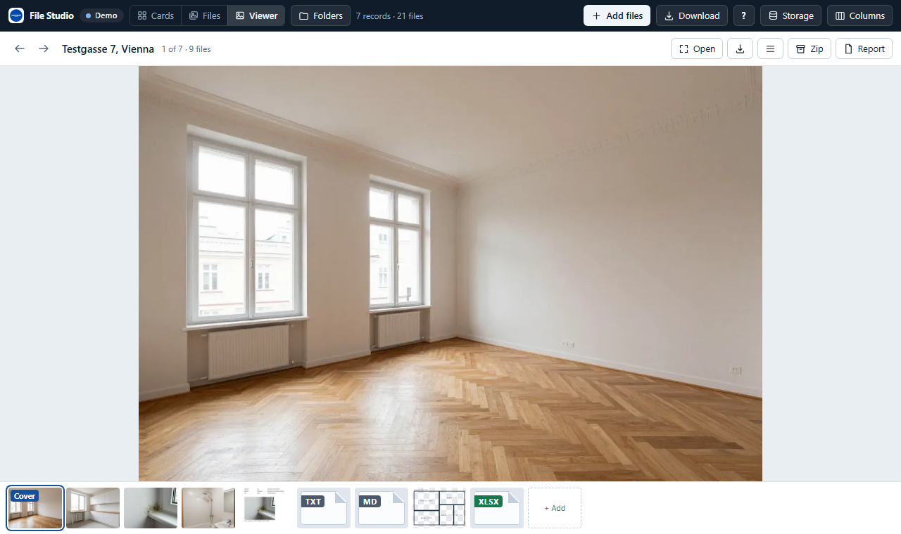

## Any file, large

The lightbox shows the file as big as the widget allows and steps through everything on show:

- **Photos:** fit or 100 %, wheel and pinch zoom around the pointer, double-click to zoom, drag to pan,
  rotate the view. Phone photos stand the right way up.
- **PDFs:** every page, drawn by pdf.js, with zoom. **Open in a new tab** gives the browser's own
  viewer for search and printing.
- **Video and audio:** played in the browser, with skipping ahead.
- **Text, CSV, JSON, Markdown, HTML:** shown as text, CSV as a table. Never run as a web page.

- **Word, Excel and PowerPoint** (`.docx`, `.xlsx`, `.pptx`): drawn on white sheets. Word shows the text with its headings,
  lists, bold, italic and underline, tables and pictures; Excel shows each sheet as a grid, with the numbers in their format,
  dates as dates in your language, percentages, merged cells and the stored result of formulas, and a tab for every sheet
  (the first 1,000 rows and 60 columns); PowerPoint shows each slide's title and text. It is the content, not the program's
  page: no page breaks, fonts, colours, charts or shapes. The file is read as data and never run. Up to 30 MB.
- **Anything else** (ZIP, the old `.doc` and `.xls`, OpenDocument, HEIC on Chrome): its type, size and a Download button.

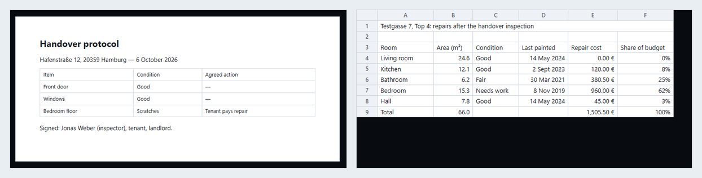

Arrow keys, swipes and the filmstrip move between files; **I** shows the details (size, picture size,
pages, length, upload date, record and column).

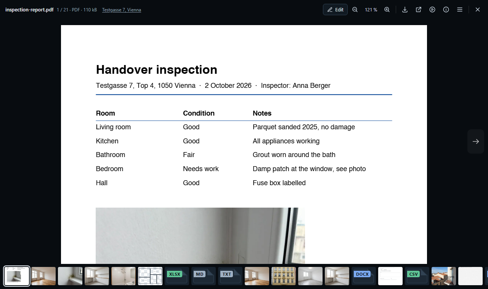

## Looking at photos

- **Slideshow.** The play button in the lightbox (or **S**) goes on to the next file by itself: a picture stays 3, 5 or 8
  seconds (More → the speed; it is remembered), a document twice as long, a video or a voice note until it ends. A thin line
  along the top shows the time left. Stepping by hand keeps it going; pressing **S** or closing the lightbox stops it.
- **Compare two pictures.** Mark two pictures and press **Compare**, or choose **Compare with the next picture** in the
  lightbox's More menu. The two sit on top of each other with a divider to drag (or, with the divider selected, the arrow
  keys): before and after, last year and this year. **Swap** changes the sides.
- **Date taken.** **Sort → Date taken** orders photos by when the camera says they were taken, oldest or newest first
  (photos with no date come last). It reads the date from the start of each JPEG, four at a time, once; the line beside
  the sort says how far it is and has **Stop**. The dates are kept in this browser, never in the document. A photo's
  **Details** (I) then also say **Taken**, the **Camera** and, when the phone was allowed to record it, the **Place**, as
  a link that opens a map only when you click it. Only JPEGs carry this; other pictures keep their upload date.

## Search inside files

The search box looks at file names, the record's title and its fields. Tick **Inside files** at the end of the box and
it also looks at the words *in* the files: PDFs (page by page), Word, Excel, PowerPoint and OpenDocument files, and text,
Markdown, CSV and HTML files.

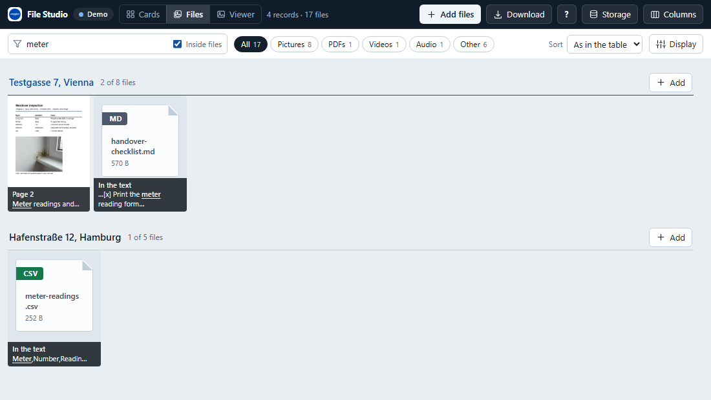

- **Reading is asked for.** The first time, File Studio says how many files it will read and how much that downloads
  (each file once) and waits for a yes. It then reads two at a time, says how far it is next to the box, and **Stop**
  halts it; **Read** carries on with what is left. Pictures, video and audio have no text, and a PDF over 80 MB, an Office
  file over 30 MB or a text file over 5 MB is skipped.
- **Kept in this browser, not in the document.** The text is stored in this browser under each file's content hash, like
  the thumbnails: the same file in two records is read once, a changed file is read again, and nothing is written to the
  document or sent anywhere. Clearing the browser's site data clears it.
- **Where the words are.** A tile says the page (**Page 3**, **Pages 3, 7**) or **In the text**, with the words around
  the match. The lightbox opens a PDF at its first page with a match and has **Next match** for the others. In Cards, a
  record shows when one of its files matches.
- **Accents and capitals do not matter** (`muller` finds Müller, `fenetre` finds Fenêtre). Every word you type must be
  somewhere in the file's name, the record or the file's own text.
- **What it cannot do.** A scanned PDF without a text layer has no words to read (there is no text recognition). A file
  that cannot be read (damaged, password-protected, too big) is counted next to the box and left out.

## Adding and arranging files

- **Drop** files on a card, a record's heading or the Viewer to add them to that record. Drop them
  anywhere else, or press **Add files**, and choose: add them to the selected record, or make **one
  new record per file**, named after the file (handy for importing a folder of photos).
- **Paste** a screenshot with Ctrl+V. On a phone, **Add files** offers the camera.
- **Shrink large photos before uploading** (an option in Columns) keeps the document small and also
  removes the location and camera data photos carry.
- **Reorder** by dragging in the Viewer's filmstrip; **Make cover** moves a file to the front.
- **Remove** takes a file out of its record; **Rename** changes its name everywhere in the document.

Every change is one Grist action, so one Undo (in Grist, in the widget's toast, or Ctrl+Z in the
widget) takes it back. Files in a formula column are shown, never changed. When the widget is
filtered by a link, new records get the linked value, so they stay in view.

## Editing files

Pictures, text files and PDFs open in an editor: **E** in the lightbox, or **Edit…** in a file's menu.
Videos, audio and office files are shown, not edited.

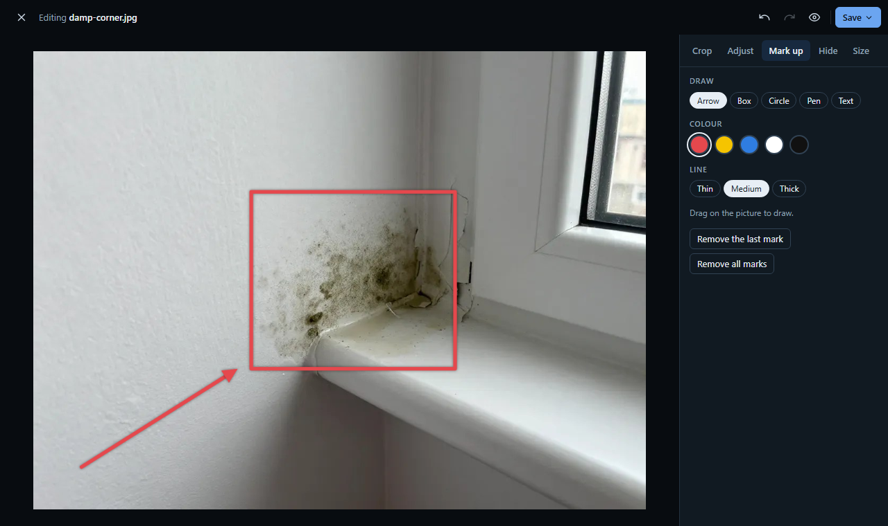

**Pictures** (JPEG, PNG, WebP, GIF, BMP, AVIF), up to 40 megapixels, edited at full size:

- **Crop** freely or to 1:1, 4:3, 3:2, 16:9 or the original shape, upright or across; turn left or
  right, flip either way, straighten by up to 45°.
- **Adjust** exposure, contrast, highlights, shadows, saturation, warmth and sharpness, or press
  **Auto** to stretch the light and take out a colour cast. Five looks (black and white, warm, cool,
  vivid, soft). Hold the eye button to see the original.
- **Mark up** with arrows, boxes, circles, a pen and text, in five colours and three line weights.
- **Hide** faces, number plates or names under blur, pixels or a black box before a picture goes out.
- **Size** sets the width in pixels, the format (as the original, JPEG, PNG or WebP) and the quality.

Saving writes a new picture, so camera data such as the place a photo was taken is not carried over.

**Text files** (TXT, CSV, TSV, JSON, Markdown, HTML, CSS, JavaScript, XML, YAML, SVG and more, up to
2 MB) open in a code editor with line numbers, syntax colours, search and replace, folding and
wrapping of long lines.

- **CSV** opens as a table: click a cell and type, Enter and Tab move on, rows and columns are added
  and removed with a button. Or switch to the raw text. The file keeps its own separator, quoting,
  line endings and byte-order mark, so Excel opens it as before.
- **Markdown, HTML and SVG** show a live preview next to the code. The HTML preview is sandboxed:
  scripts in the file do not run.
- **JSON** has a Format button. A file that is not UTF-8 opens as Windows text and is saved as UTF-8;
  the editor says so.

## PDF files

A PDF opens in an editor with up to five tabs: Pages, Fill and sign, Form (when the PDF has fields), Numbers and Finish.
It reads and writes the file in your browser; nothing is uploaded anywhere but back to your Grist.

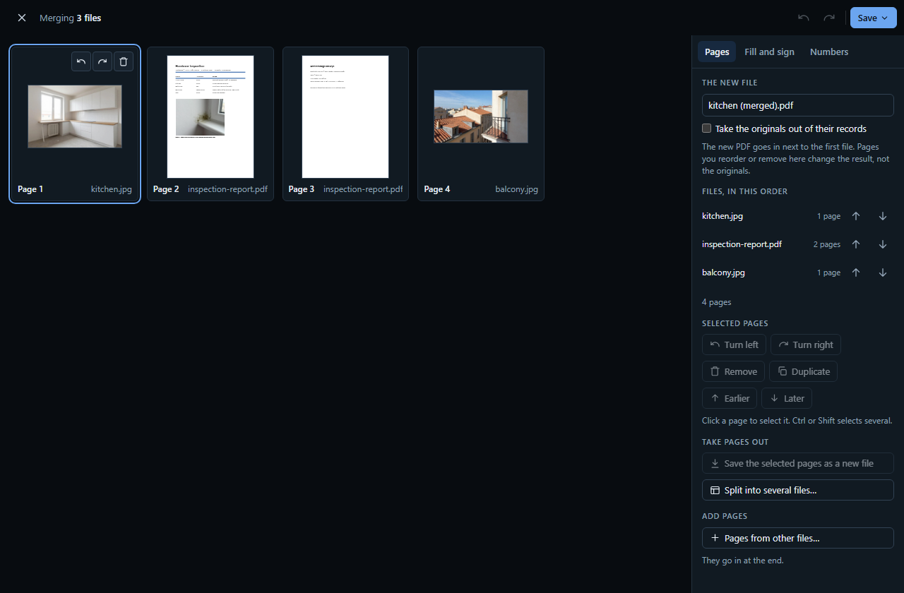

**Pages** shows every page as a thumbnail.

- Drag a page to move it (or use **Earlier** and **Later**), **turn** it, **remove** it (it stays listed as
  "Removed" until you save, and can be restored) or **duplicate** it.
- **Pages from other files…** adds the pages of other PDFs and photos, from this document or your computer;
  **A blank page** adds an empty one, the size of the page before it.
- **Save the selected pages as a new file** takes pages out; **Split into several files…** cuts the document
  up: every page on its own, every few pages, or by ranges such as `1-3, 5, 8-`. The new files land right
  after the original, in one step that Undo takes back.

**Fill and sign** puts marks on the pages: text, today's date, a tick, a cross, a **cover** (a box that hides
what is under it from view and print), a highlighter, a pen, a **picture** from your computer (a logo, a stamp)
and a **signature** you draw with the mouse, a finger or a pen. Marks can be moved, resized by their corners and recoloured, and they stay on the same spot of
the paper when a page is turned.

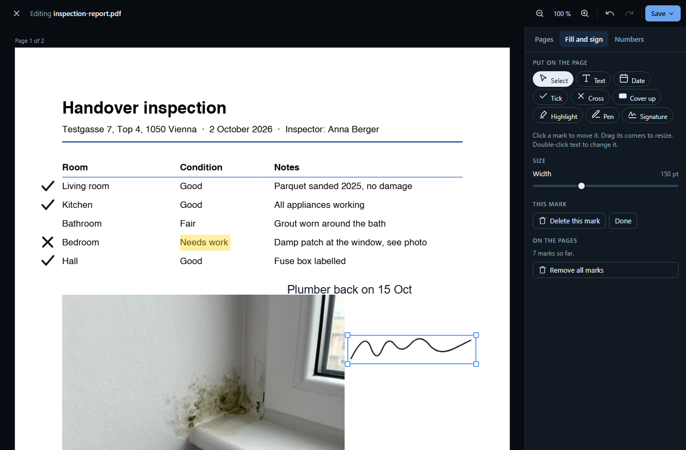

**Form** appears when the PDF has its own form fields. They are drawn on the page where they are: click one and type,
tick a box, choose from a list or a radio button. What you typed goes into the saved file. By default the fields are
flattened (what you typed is printed on the page and cannot be changed, which also survives dropping or joining
pages); untick **Make what you filled in part of the page** to keep the file a form with your entries in it, which is
possible when the document is edited where it stands.

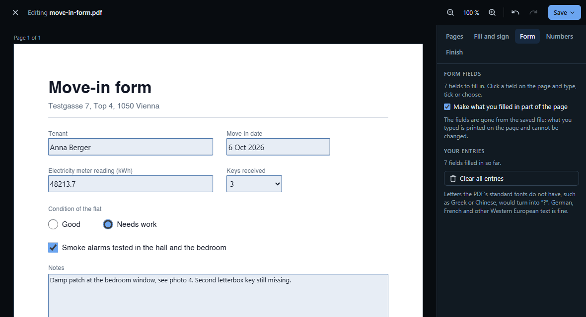

**Numbers** adds page numbers (six positions, four looks, a start number, the first page left out) and a
watermark such as DRAFT, diagonal or straight. Both go on every page of the saved file, and on every file you
split off.

**Finish** has the two things that change the whole file:

- **Turn pages into pictures** redraws pages as JPEG pictures at 100, 150 or 200 dpi: only the pages with a cover-up
  (so what was under the cover is **gone for good**, text and all), or every page (which also makes a scan smaller).
  The text of such pages can no longer be selected or searched. A cover on its own only hides: the tab says so in
  words when a page has one and the choice is still "As they are".
- **Password** asks for a password to open the file, with the choices to allow printing, copying and changing. Most PDF
  programs respect those three; some do not, so only the password itself is a lock. It is not stored anywhere: a
  forgotten password cannot be recovered.

These two apply to the file you save and to every file you split off.

**Merging.** Mark PDFs and photos in the Files layout and press **Merge into PDF…**, or choose **Merge with…**
in one file's menu. The editor opens with all their pages: put the files in order, drop or reorder pages, name
the new file, and save it next to the first one. Tick **Take the originals out of their records** to replace
them with the merged file in one step. A photo becomes a page of its own, turned upright and at most 2,600
pixels on its long side.

**What it does not do**

- It does not rewrite the text that is already in a PDF: marks sit on top of the page, which is how filling in
  and signing work. A **cover** hides, it does not redact: the text under it is still inside the file until you
  turn that page into a picture on the Finish tab.
- Marks use the PDF's standard fonts (sans, serif and mono, bold and italic): German, French and other Western
  European text is fine. Other scripts, such as Greek or Chinese, would turn into "?", and the editor warns you
  as you type.
- A password-protected PDF asks for its password; the file you save is not protected unless you set a password on
  the Finish tab. A digitally signed PDF
  loses its signature when it is changed, so the editor says so and **Save as copy** is the safer choice.
- When pages are left out or files are joined, the result is built fresh from the pages you keep, so a split-off
  page carries nothing of the others. Turning, reordering and marking edit the file where it stands, which keeps
  its bookmarks, form fields and information.
- PDFs up to 80 MB; 300 pages open in under half a second.

**Save** offers three ways:

- **Save:** the edited file takes the original's place in the cell, under the same name. If the same
  file is in other cells too (other records, other tables), the widget asks whether to update those as
  well. Either way it is one Grist action, which one Undo takes back.
- **Save as copy:** a new file next to the original, named "… (edited)".
- **Download:** to your computer only; the document stays as it is.

## Photo report

A record's photos on pages, as a PDF: the title, the record's details, the photos with their names under them, and a list
of the other files. Open it from the Viewer (**Report**), from **Download → Photo report of …**, or from the marked bar
(**Photo report…**) for the photos you marked, from any records.

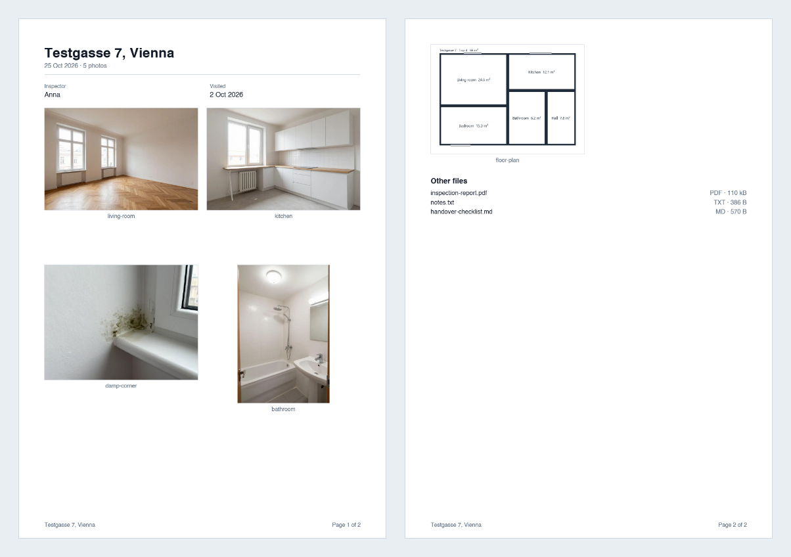

- **The options:** 1, 2, 4 or 6 photos per page, A4 or Letter (Letter where the Grist language is en-US or en-CA), the
  record's details, the file names, the list of other files. The dialog says how many pages that makes before anything
  is made. The choices are kept in this browser.
- **Where it goes:** **Add to the record** uploads it next to the photos (one Grist action, Undo takes it out of the cell);
  **Download** keeps it off the document.
- **The photos** are drawn the way they were held (the camera's turn is applied), made at most 1,500 px (2,000 at one or
  two per page) and stored as JPEG, so a report of forty phone photos is a few MB. Camera data is not copied.
- **Layout:** photos sit at the top of their place with their name right under them. A row that does not fit under what is
  already on the page goes to the next one, or is drawn a little smaller if most of it fits. Nothing is cut off.
- **Text** uses the PDF standard fonts: Western European letters are fine, Greek, Chinese and other scripts are drawn as
  "?" and reported when the report is made.

## The file manager

A file's menu (**⋯** on its tile, or the menu in the lightbox) has:

| | |
|---|---|
| **Rename…** | changes the name everywhere in the document |
| **Duplicate** | a separate copy right after it, named "… (copy)" |
| **Merge with…** | PDFs and photos into one new PDF (see PDF files) |
| **Copy to…** | the same file also in another record, picked from a searchable list |
| **Move to…** | out of this record and into another |
| **Replace with…** | a file from your computer takes its place |
| **Make cover** | moves it to the front |
| **Remove from this record** | takes it out of this cell only; other cells that hold the file keep it |
| **Remove from every place…** | takes it out of every cell that holds it, in any table, after listing them |

Neither remove deletes the file from the document straight away. A file that no cell uses any more
stays in the document for a while, so Undo can still bring it back, and Grist then deletes it (see
*Where the files live*). Formula columns are never written; they follow their formula.

In the Files layout, drag a file (or the files you marked) onto another record's group to move it there;
hold Ctrl (or Alt) to copy instead.

**Where it is** (in the lightbox's details, **I**, or in a file's menu) lists every cell in the
document that holds the file: in this table and in any other, including tables the widget does not
show. Each line names the record, the table and the column. One button shows that row right here, as
a card; the other opens Grist at that very cell.

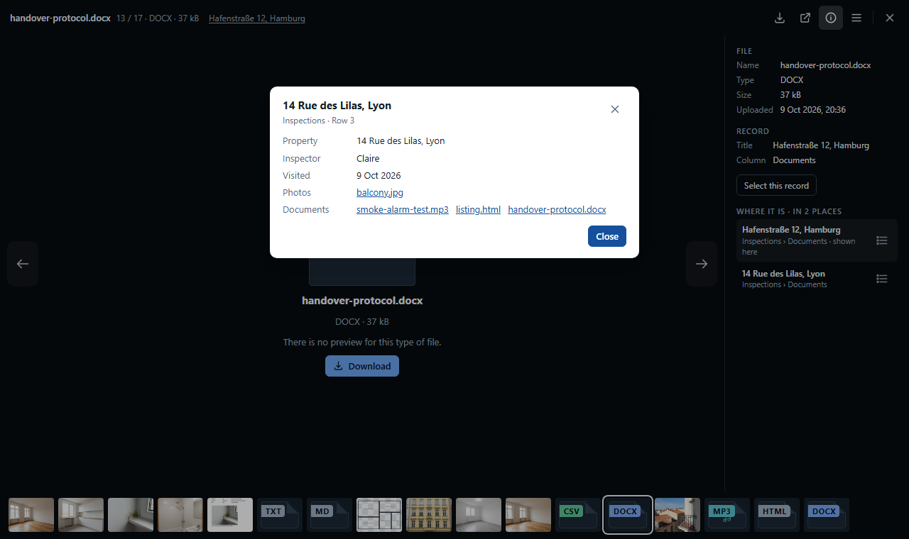

## Where the files live

In Grist a file is not inside a cell. Grist keeps each uploaded file once per document, either inside
the document itself or, when the document is set to it, in an external store (Document settings →
Attachment storage), and lists it with its name, size, picture size, upload time and a hash of its
content. An Attachments cell holds only the numbers of the files it shows. So the same file can sit in
many cells without being stored twice: that is what **Copy to** does, and what **Where it is** finds.

Grist never changes an uploaded file. **Save** therefore uploads the edited version as a new file and
points the cell, or every cell, to it. The original stays in the document while anything uses it.
Files that no cell uses any more are kept for a while, so Undo can still bring them back, and then
cleared out by Grist; how long is set by whoever runs the Grist server.

File Studio stores no files of its own. It reads them from your Grist and writes them back there,
in your browser; only the thumbnails are kept, in this browser's cache.

## Storage

A document's attachments have a size, and on Grist's hosted service it is capped at 1 GB per document. The **Storage**
button shows where the space goes and helps make room.

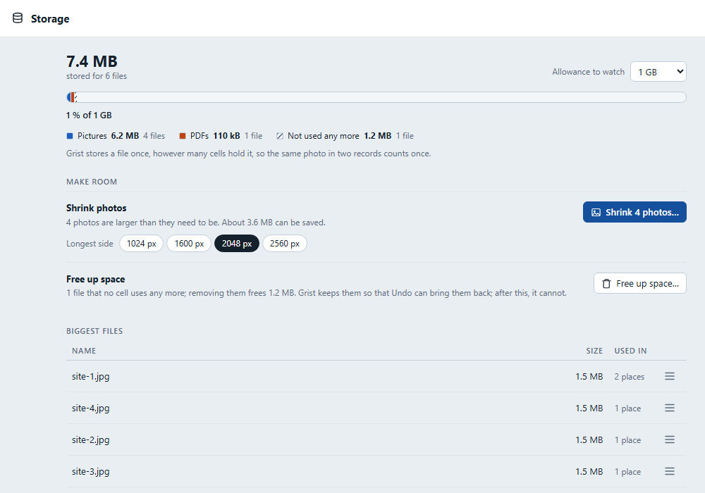

- **The picture**: the total, split into pictures, PDFs, video, audio and other, with the files nobody uses any more shown
  apart (hatched in the bar, and in words in the list). Grist stores a file once, however many cells hold it, so the same
  photo in two records counts once. An **allowance to watch** (1 GB where Grist's service applies it, none elsewhere; you
  can pick another) says how full the document is, in words as well as in the bar.
- **Shrink photos** redraws every photo that is larger than the longest side you pick (1024, 1600, 2048 or 2560 px), or
  very heavy for its size, and puts the new file where the old one was, in every cell and every table, as one step
  that Undo takes back. It shows what it expects to save first. Camera data, including where a photo was taken, is not
  kept. HEIC, GIF and SVG pictures are left alone.
- **Free up space** asks Grist to delete the files that no cell uses. Shrinking photos, replacing and removing files all
  leave old files behind: Grist keeps them so that Undo can bring them back, and they count towards the limit until
  this step. After it, Undo cannot restore them. Only an **owner** of the document can do it.
- The **biggest files** list each file's size and in how many places it is used, with **Where it is…**, **Download** and
  **Remove from every place…**.

## Getting files out

**Download** saves one file under its own name. **Download → as zip** packs the selected record's
files, everything on show, or the files you marked. In **Columns** you set how the files in a zip are
named, from your columns: `{Invoice} {Client} {nn}` turns into `R-2026-014 Müller GmbH 01.jpg`. A
zip can have a folder per record and a `files.csv` that says which file came from which record.

**Rename by a pattern** (mark files, then **Rename…**) uses the same patterns to rename the files in
Grist itself, with a preview first.

## Use it in Grist

1. Add a widget, choose **Custom**, and paste the widget URL.
2. Accept **Full document access** when Grist asks.

Full access is needed because the widget reads the files' names and contents through Grist's
document access (short-lived tokens it renews by itself), and writes your changes back. It shows the
table you chose when adding the widget and finds its Attachments columns by itself; **Columns** lets
you pick which ones, which column names a record, and what a card shows.

**Linking works both ways.** Clicking a card or a file moves Grist's cursor, so a linked card or
table follows. Linked to a table, the Viewer follows its selected row; selected by another table
(locations, projects), the wall shows only that selection's files.

**Self-hosted Grist:** thumbnails, video and zips read the files with `fetch`, which needs Grist's
API to answer cross-origin requests (it does by default). Some servers sit behind a firewall that
refuses the upload preflight; the widget then says so and the Grist cell still takes files.

## Fast with big galleries

Thumbnails are made in your browser the first time a file is on screen and kept there, under the
file's content hash, so the next visit draws at once. At most four files download at a time, and only
what is on screen is drawn: 10,000 files open in about 0.3 s and scroll at full frame rate.

## Languages and keys

English, German and French, following Grist's language (or chosen in Columns). Arrows move,
Enter opens, Space marks, Delete removes, **?** lists the rest.

## Where settings live

- **In the widget's options**, saved in the document and shared by everyone, written only when
  someone presses Save in Columns: the columns, the layout it opens in, card and tile options, zip
  naming and the upload option.
- **In this browser**: the layout last switched to, tile size, filters and sort, the interface
  language, the thumbnail cache, the text read from files for **Inside files** (with whether it is on) and the dates
  read from photos for **Date taken**.

## Building

```
npm install
npm test        # version check, shared-core check, unit tests
npm run build   # obfuscated bundle in dist/
```

`src/` runs as native modules for development (`scripts/serve.ps1` serves the folder). The files in
`src/core/` are shared with Advanced Charts and copied by `scripts/sync-core.mjs`; edit them there.
The text editor's libraries are one committed bundle, `vendor/codemirror/editor.mjs`; after changing
a CodeMirror or marked version, `node scripts/build-editor.mjs` rebuilds it with their licences. The PDF
library is the same kind of bundle, `vendor/pdflib/pdflib.mjs` (`node scripts/build-pdflib.mjs`).

## Licence

MIT, see [LICENSE](LICENSE). Bundled third-party code (Grist's plugin API, pdf.js, Sortable,
CodeMirror, marked, pdf-lib) is listed in [THIRD-PARTY-NOTICES.md](THIRD-PARTY-NOTICES.md).
